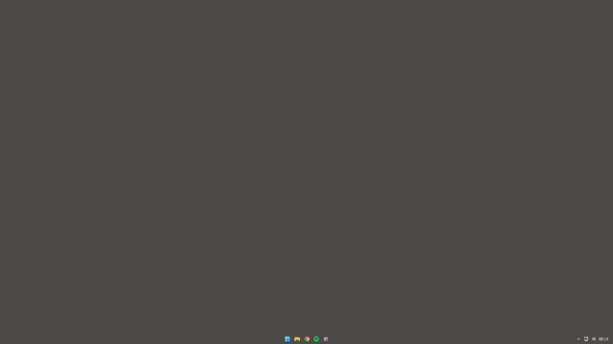

# TaskbarClear

[](LICENSE)
[](https://github.com/ilian21012005-bit/taskbar-clear/actions/workflows/build.yml)
[](https://github.com/ilian21012005-bit/taskbar-clear/releases/latest)
[-0078D4)](https://www.microsoft.com/windows)

Barre des taches **100 % transparente** (mode Clear) sur **Windows 11**, sans TranslucentTB ni Windhawk.

> **One-liner** : `git clone https://github.com/ilian21012005-bit/taskbar-clear && cd taskbar-clear && .\setup.ps1 -Silent`

- **Zero processus resident** — injection ~200 ms au logon, puis exit
- **Pas de hook global** sur fenetres / jeux — petite DLL dans `explorer.exe` uniquement
- **Optionnel** : profil `visual-clean` (animations OFF, registre HKCU)

> **Avertissement** : technique d'injection DLL dans Explorer (API non officielle Microsoft). Lisez [SECURITY.md](SECURITY.md) avant installation.



*Capture : build **26200** (25H2), mode Clear — [signaler une incompatibilite](https://github.com/ilian21012005-bit/taskbar-clear/issues/new/choose)*

## Prerequis

| Element | Detail |
|---------|--------|
| OS | Windows 11, build **22621+** (22H2+) |
| Droits | Utilisateur standard (admin **uniquement** pour exclusion Defender) |
| Antivirus | Faux positif frequent sur `inject-once.exe` — voir ci-dessous |

## Installation (recommandee)

```powershell
git clone https://github.com/ilian21012005-bit/taskbar-clear.git
cd taskbar-clear
.\setup.ps1
# ou sans questions : .\setup.ps1 -Silent
```

Le script :

1. Verifie OS et binaires
2. Propose l'exclusion Defender (fortement recommande)
3. Installe les taches logon (+30 s) et deverrouillage (+5 s)
4. Applique Clear immediatement

Guide detaille : **[docs/INSTALL.md](docs/INSTALL.md)** · Depannage : **[docs/TROUBLESHOOTING.md](docs/TROUBLESHOOTING.md)**

### Etape Defender (important)

Windows Defender peut classer `inject-once.exe` en trojan (`Bearfoos.A!ml`) et **empecher le demarrage auto** :

```powershell
.\add-defender-exclusion.ps1   # admin, une fois
```

### Installation manuelle

```powershell
.\add-defender-exclusion.ps1    # admin
.\install-task.ps1
.\apply.cmd
```

## Desinstallation

```powershell
.\uninstall-all.ps1 -RestartExplorer
```

Avec restauration des effets visuels (si `visual-clean` installe) :

```powershell
.\uninstall-all.ps1 -RestartExplorer -RestoreVisualDefaults
```

## Verifier que tout fonctionne

```powershell
.\scripts\verify-installation.ps1
.\scripts\verify-checksums.ps1
```

Journal logon : `%LOCALAPPDATA%\transparent-taskbar\inject-at-logon.log`

**Documentation** : [docs/README.md](docs/README.md) (hub) · [FAQ](docs/FAQ.md)

## Comment ca marche

```text
Logon (+30 s) → apply-at-logon.ps1 → inject-once.exe → LoadLibrary(TaskbarClear.dll) → exit
                                                      ↓
                                            explorer.exe (TAP XAML)
                                                      ↓
                               BackgroundFill / BackgroundStroke → Transparent
```

Sur Win11 25H2, `SetWindowCompositionAttribute` seul ne suffit plus (barre XAML opaque).

## Profil visual-clean (optionnel)

Tweaks registre **sans processus resident** :

```powershell
.\visual-clean\apply-visual-clean.ps1
.\visual-clean\install-visual-clean-task.ps1
```

Restauration : `.\visual-clean\restore-visual-clean.ps1`

## Compiler soi-meme

Prerequis : **VS 2022 Build Tools** (C++ + Windows SDK).

```powershell
.\native\build.ps1
.\scripts\update-checksums.ps1
.\apply.cmd
```

## Structure du depot

| Chemin | Role |
|--------|------|
| `setup.ps1` | Installation guidee |
| `bin/` | Binaires precompiles + `CHECKSUMS.sha256` |
| `install-task.ps1` / `apply-at-logon.ps1` | Demarrage automatique |
| `visual-clean/` | Profil performances visuelles |
| `scripts/` | Verification install / checksums |
| `native/` | Sources C++ |

## Limitations

- Si **Explorer redemarre**, relancez `apply.cmd` (ou attendez le deverrouillage session)
- Clear uniquement (pas blur/acrylic dynamique)
- Peut casser apres une MAJ Windows majeure
- API non officielle Microsoft

## Documentation

| Lien | Sujet |
|------|--------|
| [docs/README.md](docs/README.md) | Hub documentation |
| [docs/INSTALL.md](docs/INSTALL.md) | Installation / MAJ |
| [docs/TROUBLESHOOTING.md](docs/TROUBLESHOOTING.md) | Depannage |
| [docs/FAQ.md](docs/FAQ.md) | FPS, Defender, conflits |
| [docs/COMPATIBILITY.md](docs/COMPATIBILITY.md) | Builds Windows |
| [docs/RELATED_PROJECTS.md](docs/RELATED_PROJECTS.md) | Ecosysteme |
| [SECURITY.md](SECURITY.md) | Securite, checksums |
| [CONTRIBUTING.md](CONTRIBUTING.md) | Contribuer |
| [ROADMAP.md](ROADMAP.md) | Evolutions |

## Credits

- TAP / injection : derive de [w11-theming-suite](https://github.com/decarvalhoe/w11-theming-suite) (MIT)
- Inspiration fiabilite TAP : [TranslucentTB](https://github.com/TranslucentTB/TranslucentTB) (ExplorerTAP)

## Licence

MIT — voir [LICENSE](LICENSE).
